# Distributed Search Engine with Incremental Index Recovery

[](https://www.python.org/downloads/)
[-brightgreen.svg)](docs/DEVELOPMENT_TRACKER.md)
[](tests/)
[](docker-compose.yml)

---

## 1. Project Title
**Distributed Search Engine with Incremental Index Recovery**

---

## 2. Project Description
Distributed search engines (such as Elasticsearch or OpenSearch) achieve scale and fault tolerance by sharding an inverted index across multiple cluster nodes and replicating shards between primary and replica instances. However, when a replica experiences a transient network partition, process crash, or planned maintenance, traditional systems often resort to transferring full partition snapshots or rebuilding the inverted index from scratch. This introduces severe network I/O, disk thrashing, and prolonged synchronization delays.

This project implements a complete, self-contained distributed search engine written in Python with:
- **Custom Inverted Indexing:** In-memory inverted indexes mapping tokens to posting lists with term frequencies, document frequencies, and document lengths, without relying on third-party engines.
- **ACID Persistence via SQLite:** Independent per-shard SQLite databases configured with Write-Ahead Logging (WAL) for crash-resilient persistence.
- **Distributed BM25 Ranking:** Scatter-gather query execution using consistent global ranking-statistics snapshots ($N$, $\text{avgdl}$, $DF(t)$) ensuring distributed results strictly match an un-sharded corpus.
- **Primary-Replica Replication:** Asynchronous and streaming replication with per-shard monotonic sequence numbers.
- **Incremental Index Recovery:** Replicas track a durable applied-sequence checkpoint. When reconnecting after downtime, the system calculates the exact missing sequence range and replays only missing events from the primary's persistent update log, rather than rebuilding the full index.
- **Independent Reference Engine:** A separate single-node search engine used for continuous correctness validation.

---

## 3. Objectives
- **Document CRUD:** Monotonic versioning, replacement, and versioned tombstones to prevent stale resurrection.
- **Distributed Scatter-Gather Search:** Two-phase query execution with global ranking statistics.
- **Resilient Primary-Replica Replication:** Atomic primary writes, sequence validation, duplicate detection, and gap prevention.
- **Incremental Index Recovery:** Fast catch-up via sequence range replay $[S_{replica}+1, S_{primary}]$ with explicit failure detection if history is unavailable.
- **Verifiable Correctness:** Dual-execution validation against an independent reference engine.
- **Measurable Performance:** Benchmarked search latency, throughput, and incremental recovery speedup vs. full rebuilding.

---

## 4. Features Implemented

| Feature Area | Component | Status | Notes |
|---|---|---|---|
| Foundation | Project Skeleton & Config | **Implemented** | Python 3.13, pytest, .env, pyproject.toml |
| Protocols | gRPC & Protobuf Contracts | **Implemented** | Coordinator, Shard, Replication services |
| Storage | SQLite Schema (WAL) | **Implemented** | documents, postings, update_log, metadata |
| Indexing | Custom Inverted Index | **Implemented** | Custom Python dictionary, posting lists, document manager, tombstones |
| Ranking | BM25 Distributed Scorer | **Implemented** | Okapi BM25 with global stats snapshot, tie-breaking, length normalization |
| Persistence | Repositories & WAL Mode | **Implemented** | SQLite WAL mode, atomic BEGIN IMMEDIATE, index reconstruction on boot |
| Sharding | Coordinator Scatter-Gather | **Implemented** | Stable MD5 routing, two-phase scatter-gather with global snapshot, Top-K merger |
| Replication | Sequence Logger & Applier | **Implemented** | Monotonic sequence allocation, streaming gRPC replication, deduplication, gap detection, durable checkpointing |
| Recovery | Incremental Recovery Mgr | **Implemented** | Sequence-range replay $[S_{\text{repl}}+1, S_{\text{prim}}]$, resumption after interruption, HISTORY_UNAVAILABLE detection |
| Verification | Independent Reference Engine | **Implemented** | Dual-execution cross-validation, 100% ranking equivalence, score tolerance (<1e-5), post-recovery convergence |
| Evaluation | WikiText Benchmarking | **Implemented** | Search latency (p50: 0.69-1.74ms), recovery speedup (up to 16.28x), and 4 Matplotlib plots |
| Dashboard | Interactive Web Testing UI | **Implemented** | Browser dashboard (`http://localhost:8080`) for user-driven benchmarks, custom inputs & live metrics |
| Deployment | Docker Compose Cluster | **Implemented** | Multi-container sharded deployment with isolated volumes & Click CLI |

---

## 5. System Architecture

```mermaid
flowchart TB
    subgraph ClientLayer [Client Layer]
        CLI[Client / CLI]
    end

    subgraph CoordinatorLayer [Coordinator Node]
        Router[Deterministic Router]
        Registry[Shard Registry]
        StatsCollector[Global Stats Collector]
        Dispatcher[Query Dispatcher]
        Merger[Global Result Merger]
        RecoveryCoord[Recovery Coordinator]
    end

    subgraph Shard0 [Shard 0 Cluster]
        subgraph Primary0 [Primary Shard 0]
            P0_Handler[Shard gRPC Service]
            P0_DocMgr[Document Manager]
            P0_Index[Custom Inverted Index]
            P0_BM25[BM25 Scorer]
            P0_Seq[Sequence Manager]
            P0_Log[Update Logger]
            P0_DB[(SQLite DB Primary 0)]
        end
        subgraph Replica0 [Replica Shard 0]
            R0_Handler[Replica gRPC Service]
            R0_Applier[Replica Applier]
            R0_Index[Custom Inverted Index]
            R0_Checkpoint[Checkpoint Tracker]
            R0_DB[(SQLite DB Replica 0)]
        end
    end

    subgraph Shard1 [Shard 1 Cluster]
        subgraph Primary1 [Primary Shard 1]
            P1_Handler[Shard gRPC Service]
            P1_DocMgr[Document Manager]
            P1_Index[Custom Inverted Index]
            P1_BM25[BM25 Scorer]
            P1_Seq[Sequence Manager]
            P1_Log[Update Logger]
            P1_DB[(SQLite DB Primary 1)]
        end
        subgraph Replica1 [Replica Shard 1]
            R1_Handler[Replica gRPC Service]
            R1_Applier[Replica Applier]
            R1_Index[Custom Inverted Index]
            R1_Checkpoint[Checkpoint Tracker]
            R1_DB[(SQLite DB Replica 1)]
        end
    end

    subgraph Validation [Verification Layer]
        RefEngine[Independent Reference Engine]
    end

    CLI -->|CRUD / Search / Recovery| CoordinatorLayer
    Router -->|MD5 Hash Route| P0_Handler
    Router -->|MD5 Hash Route| P1_Handler
    Dispatcher -->|Scatter Query + Global Stats| P0_Handler
    Dispatcher -->|Scatter Query + Global Stats| P1_Handler
    P0_Handler -->|Local Top-K| Merger
    P1_Handler -->|Local Top-K| Merger
    Merger -->|Global Top-K| CLI

    %% Replication
    P0_Log -.->|gRPC Replicate Stream / Recovery| R0_Applier
    R0_Applier --> R0_Index
    R0_Applier --> R0_Checkpoint
    R0_Checkpoint --> R0_DB

    P1_Log -.->|gRPC Replicate Stream / Recovery| R1_Applier
    R1_Applier --> R1_Index
    R1_Applier --> R1_Checkpoint
    R1_Checkpoint --> R1_DB

    CLI -.->|Validation Dual Run| RefEngine
```



See [ARCHITECTURE.md](docs/ARCHITECTURE.md) for complete details on component interactions, recovery state machine, and data models. See [MATHEMATICAL_FORMULATIONS.md](docs/MATHEMATICAL_FORMULATIONS.md) for the complete theoretical reference of BM25, global statistics, hash routing, replication lag, and evaluation benchmarks.

---

## 6. Technology Stack

| Component | Selected Technology | Technical Justification |
|---|---|---|
| Language | **Python 3.13** | Fast development, strong dataclasses, type annotations, standard library support. |
| Inverted Index | **Custom Python Data Structures** | Meets strict requirement: no Elasticsearch/Whoosh backends. Uses native hash maps and posting lists. |
| Ranking | **Okapi BM25** | Industry standard probabilistic information retrieval scoring function. |
| RPC Framework | **gRPC & Protocol Buffers** | Efficient, strongly-typed, low-latency inter-process communication with streaming support. |
| Storage | **SQLite (WAL Mode)** | Independent zero-configuration ACID database per shard with concurrent read/write support. |
| Testing | **pytest** | Modular test organization with assertions, parameterization, and fixtures. |
| Evaluation | **Matplotlib & NumPy** | Statistical benchmarking and automated plot generation. |
| Deployment | **Docker Compose** | Multi-container reproducible topology with isolated persistent volumes. |

---

## 7. Repository Structure

```
distributed-search-engine/
├── client/                 # Client library and CLI tool
├── coordinator/            # Coordinator service, router, stats, query dispatcher, merger
├── indexing/               # Tokenizer, custom inverted index, document manager, BM25
├── storage/                # SQLite connection manager, schema, repositories
├── replication/            # Sequence manager, update logger, applier, recovery manager
├── services/               # gRPC servers for Shards and Replicas
├── reference/              # Independent single-node search engine for verification
├── proto/                  # Protocol Buffer contracts and compilation script
│   └── generated/          # Auto-generated Python gRPC code
├── shared/                 # Common models, enums, exceptions, and configuration
├── datasets/               # WikiText acquisition, preparation, and sample fixtures
├── scripts/                # Utility scripts (compile protos, load data, demo)
├── tests/                  # Pytest test suite
│   ├── unit/               # Unit tests (tokenization, index, BM25, schema)
│   ├── integration/        # Integration tests (storage, sharding, scatter-gather)
│   ├── replication/        # Replication tests (gap detection, deduplication)
│   ├── recovery/           # Incremental recovery tests (disconnection, replay)
│   └── system/             # End-to-end tests vs. reference engine
├── experiments/            # Benchmark scripts, raw results, and plots
├── docs/                   # Architecture, ADRs (DECISIONS.md), Development Tracker
├── docker/                 # Container deployment configs
├── Dockerfile              # Container image definition
├── docker-compose.yml      # Cluster topology compose file
├── requirements.txt        # Pinned project dependencies
├── pyproject.toml          # Project package metadata
├── pytest.ini              # Pytest configuration
└── README.md               # Project documentation
```

---

## 8. Prerequisites

- **Python:** 3.10 or newer (tested on Python 3.13)
- **Git:** Version 2.25+
- **Docker & Docker Compose:** Docker Engine 20.10+ (for multi-container deployment)
- **Memory & Storage:** 2 GB RAM, 1 GB free disk space

---

## 9. Installation

From a clean clone:

```bash
# 1. Clone repository
git clone <repository-url>
cd distributed-search-engine

# 2. Create virtual environment
python3 -m venv .venv

# 3. Activate virtual environment
# On macOS / Linux:
source .venv/bin/activate
# On Windows (PowerShell):
# .venv\Scripts\Activate.ps1

# 4. Install dependencies
pip install -r requirements.txt

# 5. Compile Protocol Buffers
python scripts/compile_protos.py
```

---

## 10. Configuration

Configuration is managed via environment variables. Copy `.env.example` to `.env`:

```bash
cp .env.example .env
```

Key configuration variables:
- `COORDINATOR_PORT`: Port for the coordinator gRPC server (default: `50050`).
- `SHARD_COUNT`: Number of logical shards (default: `2`).
- `SHARD_0_PRIMARY_PORT`: Port for Shard 0 Primary (default: `50051`).
- `SHARD_0_REPLICA_PORT`: Port for Shard 0 Replica (default: `50061`).
- `DATA_DIR`: Base directory for SQLite databases (default: `./data`).

---

## 11. Dataset Acquisition and Generation

The system supports both offline deterministic test fixtures and the WikiText benchmark dataset.

- **Offline deterministic test fixtures:** Bundled in `tests/fixtures/` for instant zero-network test execution.
- **WikiText dataset pipeline (M8):**
  ```bash
  # Download WikiText raw articles
  python scripts/download_dataset.py --variant wikitext-2-raw-v1

  # Prepare clean JSONL with deterministic IDs
  python scripts/prepare_dataset.py --input datasets/raw/wikitext-2.txt --output datasets/processed/corpus.jsonl --limit 10000

  # Validate formatted dataset integrity
  python scripts/validate_dataset.py --input datasets/processed/corpus.jsonl
  ```

---

## 12. Database Setup

Each shard maintains an independent SQLite database in `$DATA_DIR`:
- `data/shard_0_primary.db`
- `data/shard_0_replica.db`
- `data/shard_1_primary.db`
- `data/shard_1_replica.db`

Databases are automatically initialized with WAL mode and schema on first run. To reset the environment safely:
```bash
rm -rf ./data/*.db ./data/*.db-wal ./data/*.db-shm
```

---

## 13. Starting the System

### Running via Docker Compose (Recommended for full cluster)
```bash
docker-compose up --build
```

### Running locally with independent processes
```bash
# Terminal 1: Shard 0 Primary
python -m services.shard_server --shard-id 0 --role PRIMARY --port 50051

# Terminal 2: Shard 0 Replica
python -m services.replica_server --shard-id 0 --port 50061 --primary-address localhost:50051

# Terminal 3: Shard 1 Primary
python -m services.shard_server --shard-id 1 --role PRIMARY --port 50052

# Terminal 4: Shard 1 Replica
python -m services.replica_server --shard-id 1 --port 50062 --primary-address localhost:50052

# Terminal 5: Coordinator
python -m coordinator.server --port 50050
```

---

## 14. End-to-End Usage

The CLI client (`client/cli.py`) allows interactive control:

```bash
# Insert a document
python client/cli.py insert --doc-id doc_101 --content "Distributed systems rely on consensus and replication"

# Replace a document
python client/cli.py replace --doc-id doc_101 --content "Distributed systems rely on replication and recovery" --version 1

# Search with top-k
python client/cli.py search --query "distributed replication" --top-k 5

# Delete a document (creates tombstone)
python client/cli.py delete --doc-id doc_101 --version 2

# Inspect cluster and shard status
python client/cli.py status
```

---

## 15. Replication Demonstration

1. Start Primary and Replica for Shard 0.
2. Insert 50 documents via Coordinator.
3. Observe replica `last_applied_sequence` match primary `latest_sequence` (lag = 0).
4. Terminate Replica Shard 0 process (simulating outage).
5. Insert 100 additional documents into Shard 0.
6. Verify primary continues serving writes; lag increases to 100.
7. Restart Replica Shard 0.
8. Trigger incremental recovery:
   ```bash
   python client/cli.py recover --shard-id 0
   ```
9. Verify that **only** sequence range $[51..150]$ (100 events) is replayed.
10. Check that replica applied sequence reaches 150 and status becomes `SYNCHRONIZED`.

---

## 16. Failure and Recovery Demonstration

The test suite includes dedicated failure-injection scenarios:
- **Duplicate Delivery:** Delivering sequence $N$ twice results in duplicate detection and no double-application.
- **Sequence Gap:** Delivering sequence $N+2$ before $N+1$ raises `SEQUENCE_GAP` and halts replay.
- **Stale Updates:** Delivering an update with version $\le$ existing version is rejected with `STALE_VERSION`.
- **Tombstone Protection:** Inserting a document with an older version than an existing deletion tombstone fails with `TOMBSTONE_CONFLICT`.
- **Truncated Log:** If requested sequence is older than available history, primary returns `HISTORY_UNAVAILABLE`.

---

## 17. Testing Instructions

Execute the automated test suite with pytest:

```bash
# Run all tests
pytest

# Run unit tests only
pytest tests/unit/

# Run integration tests
pytest tests/integration/

# Run replication failure scenarios
pytest tests/replication/

# Run incremental recovery tests
pytest tests/recovery/

# Run system cross-validation against Reference Engine
pytest tests/system/
```

---

## 18. Performance Evaluation & Empirical Results

The system was evaluated against a real 500-document WikiText-2 processed corpus using real gRPC transport, atomic SQLite persistence (WAL mode), thread-safe sequence tracking, and custom Python BM25 inverted index ranking.

### 18.1 Distributed Search Performance
- **Single Shard:** Throughput ~ 1,225 QPS, $p_{50}$ latency = 0.69 ms, $p_{95}$ latency = 1.64 ms.
- **2 Shards:** Throughput ~ 963 QPS, $p_{50}$ latency = 0.98 ms, $p_{95}$ latency = 1.40 ms.
- **4 Shards:** Throughput ~ 587 QPS, $p_{50}$ latency = 1.67 ms, $p_{95}$ latency = 1.99 ms.

Across all shard topologies, scatter-gather query execution maintains sub-2ms median latency.

### 18.2 Incremental Recovery vs. Full Rebuild
$$\text{Speedup} = \frac{T_{\text{Full Rebuild}}}{T_{\text{Incremental Recovery}}}, \quad \text{Data Reduction (\%)} = \left(\frac{B_{\text{Full}} - B_{\text{Incr}}}{B_{\text{Full}}}\right) \times 100\%$$

| Missed Updates | Incremental Time ($T_{\text{incr}}$) | Full Rebuild Time ($T_{\text{full}}$) | Speedup Ratio | Data Saved (%) | Convergence Verified |
|---|---|---|---|---|---|
| **10 updates** | **0.0066 s** | 0.1077 s | **16.28x** | **96.1%** | YES (100% Score & Rank Match) |
| **25 updates** | **0.0136 s** | 0.1042 s | **7.68x** | **90.5%** | YES (100% Score & Rank Match) |
| **50 updates** | **0.0272 s** | 0.1058 s | **3.89x** | **80.5%** | YES (100% Score & Rank Match) |
| **100 updates** | **0.0548 s** | 0.1107 s | **2.02x** | **61.0%** | YES (100% Score & Rank Match) |
| **150 updates** | **0.0750 s** | 0.1039 s | **1.39x** | **41.5%** | YES (100% Score & Rank Match) |
| **200 updates** | **0.0874 s** | 0.1068 s | **1.22x** | **22.0%** | YES (100% Score & Rank Match) |

Visual charts are generated and saved under `experiments/plots/`:
- `search_latency_vs_shards.png`
- `search_throughput_vs_topk.png`
- `recovery_time_incremental_vs_full.png`
- `recovery_speedup_and_data_reduction.png`

---

## 19. Evaluation & Quick-Start Guide

### 19.1 Automated 1-Command Verification
Run the automated end-to-end evaluation script demonstrating multi-shard startup, document ingestion, BM25 search, version replacement, tombstones, replica lag, incremental recovery, and 100% convergence:
```bash
python scripts/run_demo.py
```

### 19.2 Run Full Test Suite
Execute the 63 unit, integration, replication, recovery, and system cross-validation tests:
```bash
pytest
```

### 19.3 Command-Line Interface (CLI) Usage
```bash
# Inspect cluster health, sequence numbers, and replication lag
python -m client.cli status

# Insert a new document
python -m client.cli insert -i "doc_101" -c "Distributed transactions and atomic commit protocols"

# Execute distributed scatter-gather search
python -m client.cli search -q "atomic commit" -k 5

# Replace document with monotonic version verification (version 1 -> 2)
python -m client.cli replace -i "doc_101" -c "Updated text on distributed atomic commit protocols" -v 1

# Delete document (generates versioned tombstone)
python -m client.cli delete -i "doc_101" -v 2

# Trigger incremental recovery for a lagging replica
python -m client.cli recover -s 0
```

### 19.4 Web UI Dashboard Testing (Interactive Workbench)

A zero-dependency HTTP web dashboard is provided at `client/web_dashboard.py`. It translates browser UI actions to live gRPC calls via `SearchEngineClient`, allowing users to provide custom inputs and inspect real-time performance metrics directly in the browser.

#### 1. Start the Web Dashboard Server
```bash
# Start the web dashboard (serves on port 8080, connects to Coordinator on 127.0.0.1:50050)
python client/web_dashboard.py --port 8080 --coordinator 127.0.0.1:50050
```
Open **[http://localhost:8080](http://localhost:8080)** in your browser.

#### 2. How to Test Each Feature in the Web UI:

- **⚡ Custom Search Benchmark (Tab 1):**
  - **Input:** Type or paste your own list of queries in the textarea (one per line). Set repetitions (e.g., `30`) and top-$k$ depth (`5`, `10`, or `20`).
  - **Action:** Click **"▶ Run Custom Benchmark"**.
  - **Metrics Collected:** Live measured **QPS throughput**, latency distribution (**$p_{50}$ median, $p_{95}$, $p_{99}$ tail latencies** in milliseconds), Min, Mean, and Max latency, accompanied by graphical percentile progress bars.

- **🔄 Custom Recovery & Speedup Benchmark (Tab 2):**
  - **Input:** Choose target shard (`Shard 0` or `Shard 1`), specify the number of missed writes to inject (e.g., `25` or `50`), and set replay batch size.
  - **Action:** Click **"▶ Run Recovery & Speedup Test"**.
  - **Metrics Collected:** Live measured **Incremental duration ($T_{\text{incr}}$)** vs. **Full Rebuild duration ($T_{\text{full}}$)**, **Speedup Ratio ($T_{\text{full}} / T_{\text{incr}}$)**, **Network bytes transferred**, **Data Saved percentage (%)**, and a live transcript confirming that the replica applied sequence matches the primary.

- **⚖️ Dual-Engine Oracle Validator (Tab 3):**
  - **Input:** Enter any search query string.
  - **Action:** Click **"Validate Equivalence"**.
  - **Metrics Collected:** Executes search concurrently against both the Distributed Cluster and the independent single-node Reference Engine. Displays side-by-side rankings and verifies that the maximum score discrepancy $\Delta = |Score_{\text{dist}} - Score_{\text{ref}}| < 10^{-5}$ with a green `VALIDATION PASSED` badge.

- **📝 Manual CRUD & Monotonic Version Management (Tab 4):**
  - **Input:** Enter `Doc ID`, `Content`, and `Expected Version`.
  - **Insert:** Validates deterministic MD5 routing to Shard 0 or 1 and allocates a monotonic sequence number.
  - **Replace:** Tests version increment ($v_1 \to v_2$). If you specify a stale expected version, it displays the rejected `StaleVersionError`.
  - **Delete:** Creates a versioned tombstone, removes postings from inverted search results, and demonstrates anti-resurrection protection.

- **📦 Custom Batch Ingestion (Tab 5):**
  - **Input:** Paste multiple JSONL document records in the textarea.
  - **Action:** Click **"Ingest Batch"**.
  - **Metrics Collected:** Measures batch ingestion elapsed time, ingestion rate (documents/second), and per-shard distribution count.

---

### 19.5 Docker & Docker Compose Deployment
Deploy the full 2-shard cluster (Coordinator + 2 Primaries + 2 Replicas) with persistent volumes:
```bash
# Build and start all 5 microservices in the background
docker-compose up --build -d

# Verify container health and port bindings
docker-compose ps

# Bulk ingest WikiText dataset into the Docker cluster
python scripts/load_documents.py --coordinator 127.0.0.1:50050 --max-docs 100

# Execute searches against the Dockerized coordinator
python -m client.cli --coordinator 127.0.0.1:50050 search -q "search engine architecture"

# Tear down cluster and remove containers
docker-compose down -v
```

---

## 20. Known Limitations
- Automatic primary leader election and consensus (Raft/Paxos) are intentionally outside course project scope. Shard roles (Primary/Replica) are fixed by configuration.
- Dynamic resharding (splitting or merging active shards online) is not supported; shard count is fixed at cluster startup.

---

## 21. Troubleshooting
- **Port already in use:** Verify that background servers are terminated: `lsof -i :50050` or kill dangling Python processes.
- **Proto import error:** Run `python scripts/compile_protos.py` to regenerate `proto/generated/`.
- **Database lock / busy:** Ensure connections use WAL mode (`PRAGMA journal_mode=WAL;`).

---

## 22. Contributors
- Course: Distributed Systems (Monsoon 2026)
- Role: Primary Developer / Distributed Systems Architect

---

## 23. License and References
- Dataset: WikiText-2 / WikiText-103 (Creative Commons Attribution-ShareAlike License).
- Reference: Okapi BM25 ranking formulation (Robertson et al., 1994).
