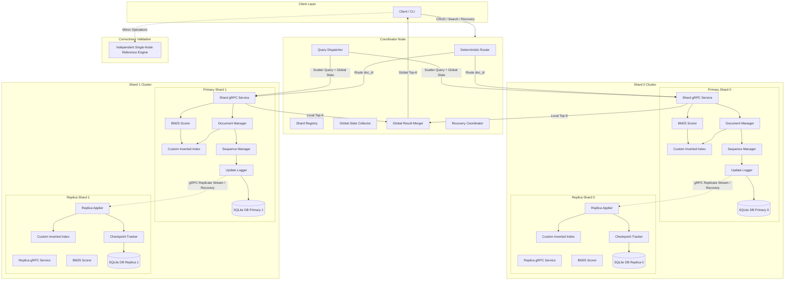
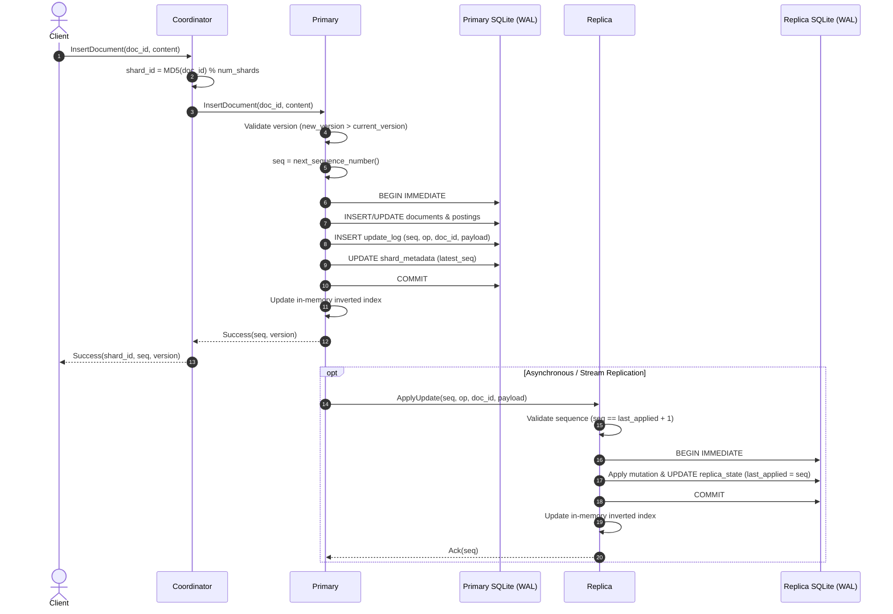
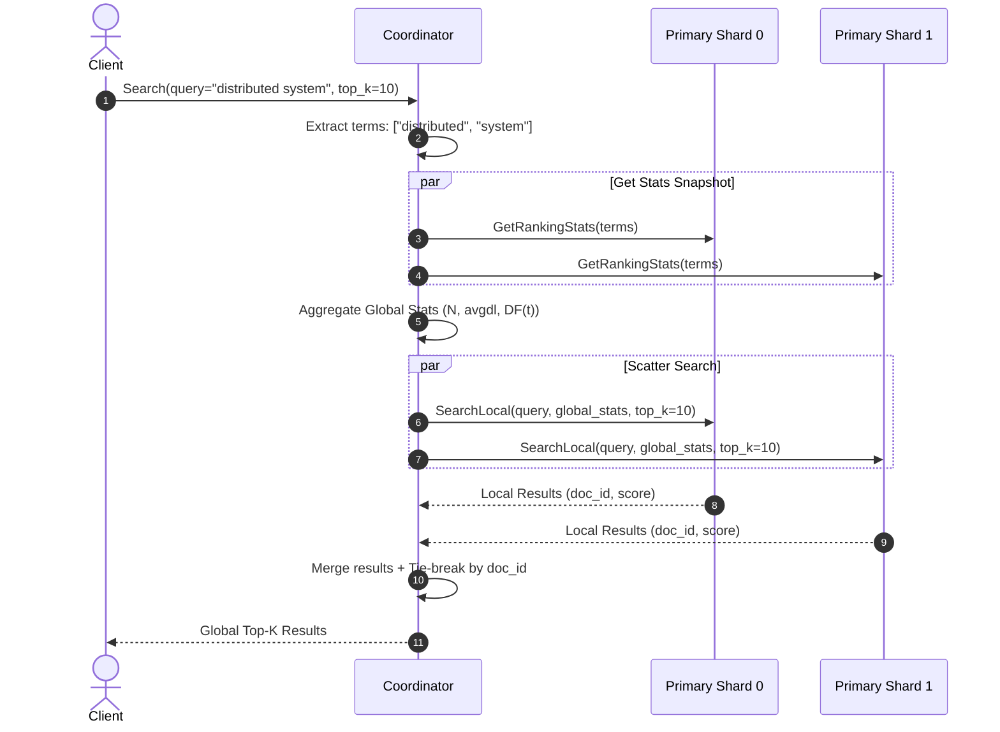
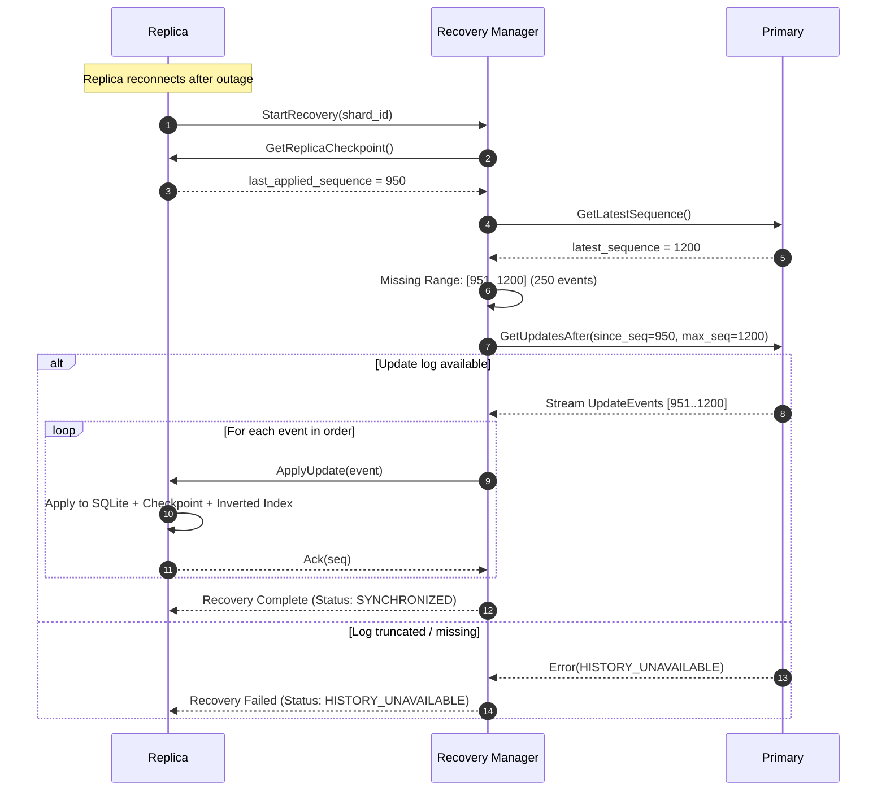

# System Architecture

## Distributed Search Engine with Incremental Index Recovery

This document describes the architectural design, component interactions, data models, protocols, and workflows of the distributed search engine.

---

## 1. Architectural Overview

The system is a distributed, sharded text search engine inspired by Elasticsearch, engineered to provide high search throughput, partitioning, primary-replica fault tolerance, and incremental index recovery after disconnection.

### 1.1 High-Level Architecture Diagram



---

## 2. Core Components

### 2.1 Coordinator
- **Deterministic Router:** Maps each `doc_id` to its owning `shard_id` via MD5 hash modulo `num_shards`.
- **Shard Registry:** Maintains network endpoints (gRPC host/port) and health status of all primary and replica shards.
- **Global Stats Collector:** Queries primary shards to aggregate global corpus statistics ($N_{total}$, $avgdl$, term document frequencies $DF(t)$) needed for globally comparable BM25 scoring.
- **Query Dispatcher:** Scatters search requests along with the global ranking statistics snapshot to all primary shards concurrently.
- **Result Merger:** Collects local top-k result sets from shards, merges them into a global top-k ranking, and breaks ties deterministically by `doc_id`.
- **Recovery Coordinator:** Provides client-facing triggers and status inspection for shard recovery operations.

### 2.2 Primary Shard
- **Shard gRPC Service:** Exposes document CRUD, local search, statistics reporting, and update-log streaming.
- **Document Manager:** Validates document versions, prevents stale writes, creates tombstones upon deletion, and manages posting modifications.
- **Custom Inverted Index:** In-memory index maintaining term postings (`term -> {doc_id: tf}`), term document frequencies, and document lengths.
- **BM25 Scorer:** Evaluates multi-term queries against local postings using the globally supplied ranking statistics snapshot.
- **Sequence Manager:** Allocates monotonically increasing sequence numbers (1, 2, 3...) per shard.
- **Update Logger:** Atomically commits mutation records to SQLite `update_log`.

### 2.3 Replica Shard
- **Replica gRPC Service:** Exposes replication endpoints (`ApplyUpdate`, `GetCheckpoint`) and status queries.
- **Replica Applier:** Enforces strict ordering, detects sequence gaps, ignores duplicate events, rejects stale document versions, and preserves tombstones.
- **Checkpoint Tracker:** Atomically persists `last_applied_sequence` to SQLite `replica_state`.
- **Independent Index:** Maintains its own in-memory inverted index and SQLite storage.

### 2.4 Recovery Manager
- Coordinates incremental recovery when a replica reconnects after downtime or disconnection.
- Computes missing sequence ranges $[S_{replica} + 1, S_{primary}]$.
- Retrieves ordered log events from the primary's `update_log` table.
- Streams events to the replica, which validates, applies, and commits each event.
- Verifies that log history is intact; reports `HISTORY_UNAVAILABLE` if logs are missing.

### 2.5 Independent Reference Engine
- A completely independent, single-node in-memory search engine.
- Implements text normalization, tokenization, index storage, and BM25 ranking without sharding, RPCs, or coordinator dependencies.
- Used in tests to execute identical workloads and verify distributed search rankings, BM25 scores, and replica convergence.

---

## 3. Data Flow & Workflows

### 3.1 Document Write Workflow (Insert / Replace / Delete)


### 3.2 Distributed Search Workflow (Scatter-Gather with Global Stats)


### 3.3 Incremental Replica Recovery Workflow


---

## 4. SQLite Storage Schema

Each primary and replica node manages an independent SQLite database with Write-Ahead Logging (`PRAGMA journal_mode=WAL;` and `PRAGMA synchronous=NORMAL;`).

```sql
-- documents: Stores document state and tombstones
CREATE TABLE IF NOT EXISTS documents (
    doc_id TEXT PRIMARY KEY,
    content TEXT NOT NULL,
    version INTEGER NOT NULL,
    is_deleted INTEGER NOT NULL DEFAULT 0,
    document_length INTEGER NOT NULL,
    created_at TIMESTAMP DEFAULT CURRENT_TIMESTAMP,
    updated_at TIMESTAMP DEFAULT CURRENT_TIMESTAMP
);

-- postings: Stores inverted index term frequencies
CREATE TABLE IF NOT EXISTS postings (
    term TEXT NOT NULL,
    doc_id TEXT NOT NULL,
    term_frequency INTEGER NOT NULL,
    PRIMARY KEY (term, doc_id),
    FOREIGN KEY (doc_id) REFERENCES documents(doc_id) ON DELETE CASCADE
);
CREATE INDEX IF NOT EXISTS idx_postings_term ON postings(term);

-- update_log: Persistent per-shard write-ahead log for replication
CREATE TABLE IF NOT EXISTS update_log (
    shard_id INTEGER NOT NULL,
    sequence_number INTEGER NOT NULL,
    doc_id TEXT NOT NULL,
    operation TEXT NOT NULL, -- INSERT, REPLACE, DELETE
    version INTEGER NOT NULL,
    payload TEXT,            -- JSON-serialized document or delta
    committed_at TIMESTAMP DEFAULT CURRENT_TIMESTAMP,
    PRIMARY KEY (shard_id, sequence_number)
);
CREATE INDEX IF NOT EXISTS idx_log_seq ON update_log(shard_id, sequence_number);

-- shard_metadata: Stores shard sequence counter and statistics
CREATE TABLE IF NOT EXISTS shard_metadata (
    shard_id INTEGER PRIMARY KEY,
    latest_committed_sequence INTEGER NOT NULL DEFAULT 0,
    total_documents INTEGER NOT NULL DEFAULT 0,
    total_length INTEGER NOT NULL DEFAULT 0,
    updated_at TIMESTAMP DEFAULT CURRENT_TIMESTAMP
);

-- replica_state: Tracks checkpoint sequence of the replica
CREATE TABLE IF NOT EXISTS replica_state (
    shard_id INTEGER PRIMARY KEY,
    replica_id TEXT NOT NULL,
    last_applied_sequence INTEGER NOT NULL DEFAULT 0,
    status TEXT NOT NULL DEFAULT 'DISCONNECTED',
    updated_at TIMESTAMP DEFAULT CURRENT_TIMESTAMP
);
```

---

## 5. Ranking Formulation: BM25 with Global Statistics

The system implements the Okapi BM25 ranking algorithm:

$$\text{Score}(D, Q) = \sum_{t \in Q} \text{IDF}(t) \cdot \frac{f(t, D) \cdot (k_1 + 1)}{f(t, D) + k_1 \cdot \left(1 - b + b \cdot \frac{|D|}{\text{avgdl}}\right)}$$

Where:
- $f(t, D)$ is the term frequency of $t$ in document $D$ (from local shard postings).
- $|D|$ is the length of document $D$ in tokens.
- $\text{avgdl} = \frac{\sum_{i=1}^{N} |D_i|}{N}$ is the **global average document length** aggregated across all primary shards.
- $N$ is the **global count of non-deleted documents** across all primary shards.
- $\text{IDF}(t) = \ln\left(1 + \frac{N - DF(t) + 0.5}{DF(t) + 0.5}\right)$ is calculated using the **global document frequency** $DF(t)$ of term $t$.
- Default hyperparameters: $k_1 = 1.2$, $b = 0.75$.

Deterministic tie-breaking: If two documents have identical scores within $10^{-6}$, ties are broken by ascending `doc_id`.

For complete mathematical derivations, parameter sensitivity analysis, distributed aggregation invariants, and recovery benchmark metrics, see [docs/MATHEMATICAL_FORMULATIONS.md](MATHEMATICAL_FORMULATIONS.md).
